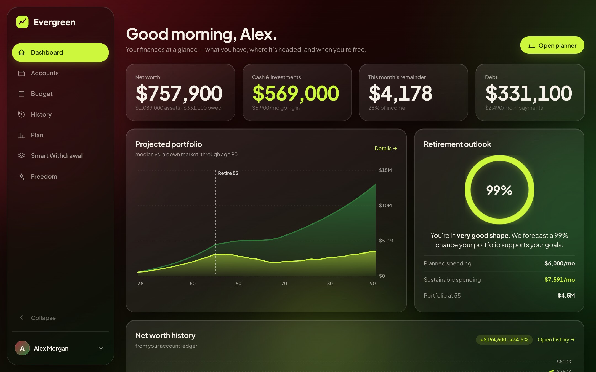
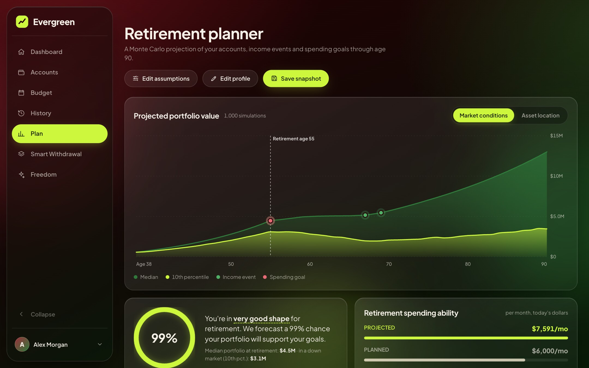
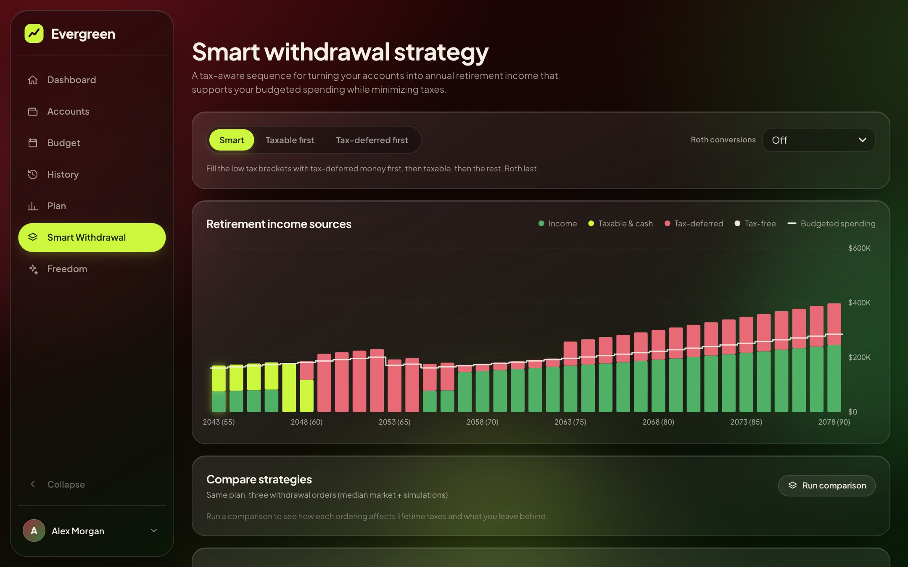
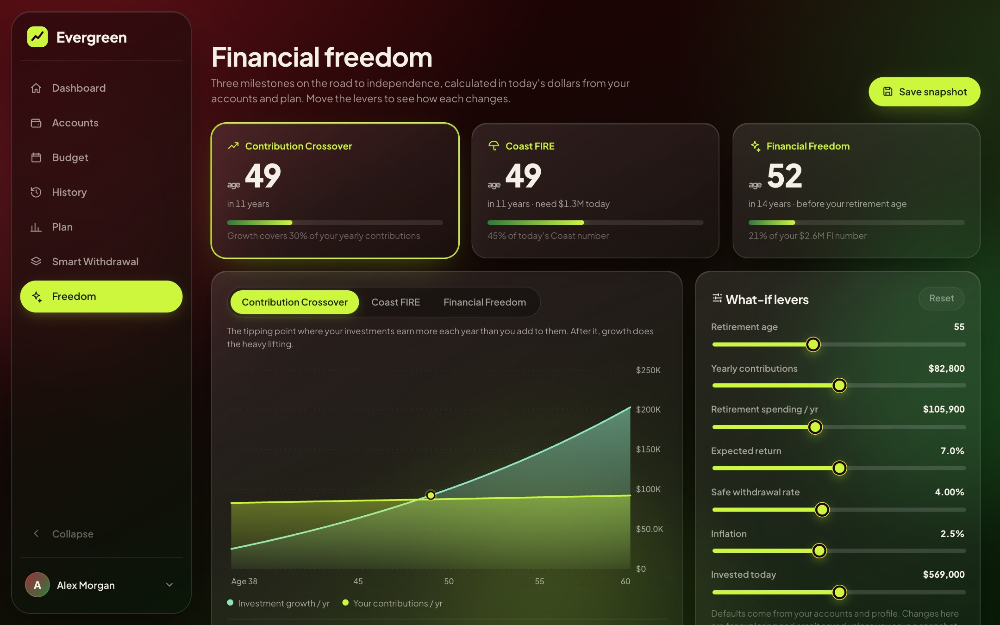
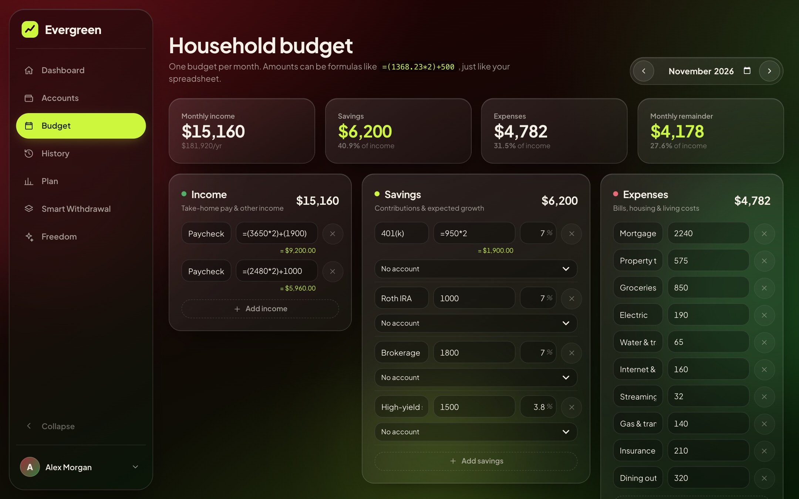
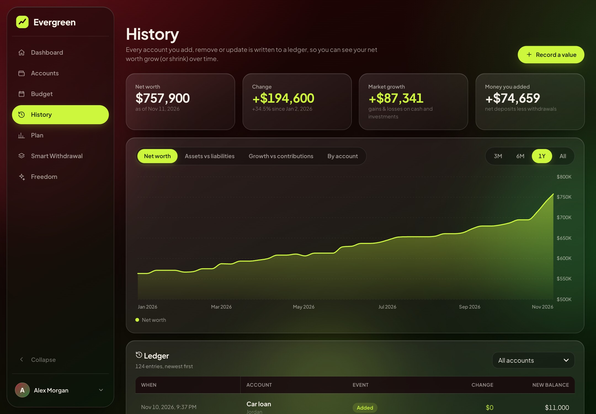
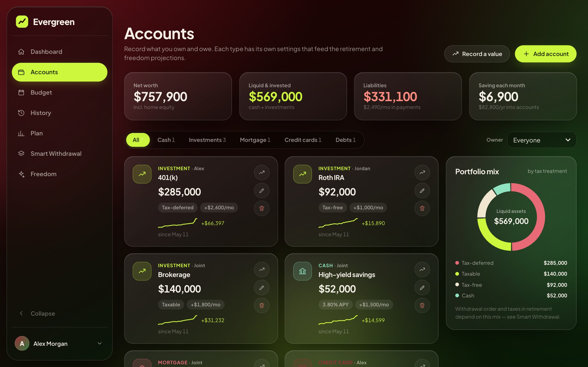

# Evergreen

**A local-first financial planner.** Budget by month, project your retirement with Monte Carlo simulation, plan tax-smart withdrawals, and see exactly when you hit Coast FIRE and financial freedom — with everything stored in a SQLite database on your own machine.



<table>
  <tr>
    <td width="50%"><br><sub><b>Plan</b> — Monte Carlo projection, success probability, income events and spending goals, cash-flow table</sub></td>
    <td width="50%"><br><sub><b>Smart Withdrawal</b> — where each year's retirement income comes from, with taxes</sub></td>
  </tr>
  <tr>
    <td width="50%"><br><sub><b>Freedom</b> — Contribution Crossover, Coast FIRE and Financial Freedom with what-if levers</sub></td>
    <td width="50%"><br><sub><b>Budget</b> — monthly income, savings and expenses with spreadsheet-style formulas</sub></td>
  </tr>
  <tr>
    <td width="50%"><br><sub><b>History</b> — net worth over time, growth vs. contributions, and the ledger behind it</sub></td>
    <td width="50%"><br><sub><b>Accounts</b> — every account by owner, with its balance trend from the ledger</sub></td>
  </tr>
</table>

> The screenshots use fixture data for a made-up household.

## Features

- **Accounts** — cash, investments, mortgage, credit cards and debts, each with settings of its own:
  - *Cash*: balance, APY, monthly deposit
  - *Investments*: tax treatment (taxable / tax-deferred / tax-free), contributions, employer match, expected return, fees, cost basis
  - *Mortgage*: balance, rate, term, payment, home value and appreciation, property tax, insurance
  - *Credit card*: balance, APR, limit, payment, paid-in-full toggle
  - *Debt*: type, balance, rate, term, payment
- **History & ledger** — every account you add, remove or update is written to an append-only ledger, so net worth, assets vs. liabilities and per-account balances can be charted over time. Use **Record a value** to log a new statement balance (optionally backdated) and say what changed: a market move, a deposit, a withdrawal, a payment. Deposits and withdrawals are tracked separately, so the History page can split your change into **market growth** and **money you added**.
- **Household** — first and last name, age (stored as a birth year, so it advances on its own and feeds every projection), and household members. Accounts can be owned by you, a member, or Joint; income events such as Social Security use their owner's age.
- **Budget** — one budget per month with Income / Savings / Expenses, formula amounts (`=(1368.23*2)+500`), growth estimates on savings lines, an annual outlook, copy-from-last-month, and a starter template modelled on a household budget spreadsheet. "Use in retirement plan" pushes income, expenses and linked savings contributions into your profile and accounts.
- **Plan** — Monte Carlo projection (median vs. 10th percentile), probability of success, sustainable monthly spending, income events and spending goals, and a detailed cash-flow table. Save snapshots to compare scenarios.
- **Smart Withdrawal** — year-by-year retirement income sources (income events, taxable, tax-deferred, tax-free), estimated taxes, budgeted spending and balances, with required minimum distributions, optional Roth conversions and a side-by-side comparison of three withdrawal orders.
- **Freedom** — Contribution Crossover, Coast FIRE and Financial Freedom, with sliders for retirement age, contributions, spending, return, withdrawal rate and inflation.
- **Accounts & security** — email and password sign-in; sessions are HttpOnly cookies, passwords are bcrypt-hashed, and every record is scoped to its owner. Change your email or password from the account menu.
- **Responsive UI** — a frosted-glass interface with a collapsible left sidebar on tablet-landscape and wider screens and a top bar on smaller ones.

## Tech stack

| Layer     | Tech                                                                |
| --------- | ------------------------------------------------------------------- |
| Frontend  | Vue 3 + TypeScript (Vite), hand-written SVG charts, no UI framework |
| API       | Go (`net/http`), cookie sessions, bcrypt                            |
| Database  | SQLite (pure-Go `modernc.org/sqlite`, no CGO), stored in a volume   |
| Packaging | Docker Compose (nginx serves the SPA and proxies `/api`)            |

## Run it with Docker

```bash
docker compose up --build
```

Open <http://localhost:8080>, create an account, and start with **Accounts → Add account**.

Data lives in the `wellness-data` Docker volume (`/data/wellness.db` in the API container), so it survives restarts and rebuilds. To back it up:

```bash
docker compose cp api:/data/wellness.db ./wellness-backup.db
```

To stop the app and keep your data: `docker compose down`. To wipe everything: `docker compose down -v`.

If you serve the app over HTTPS, set `COOKIE_SECURE: "true"` on the `api` service.

## Develop locally

Requires Go 1.26+, Node 22+ and pnpm.

```bash
# terminal 1 — API on :8081, SQLite at backend/data/wellness.db
cd backend && go run .

# terminal 2 — Vite dev server on :5173 (proxies /api to :8081)
cd frontend && pnpm install && pnpm dev
```

Tests and checks:

```bash
cd backend && go vet ./... && go test ./...
cd frontend && pnpm build        # type-checks (vue-tsc) and builds
```

## How the simulations work

All of the math lives in [`backend/internal/sim`](backend/internal/sim).

- **Returns.** Each year's market return is log-normal with the mean and volatility you set (one shared market shock across investment buckets; cash earns its APY). The "median" line is the median-market path; the 10th percentile comes from 1,000 seeded trials, so results are reproducible.
- **Buckets.** Balances are tracked as cash, taxable (with cost basis), tax-deferred and tax-free, each with its own weighted expected return.
- **Liabilities.** Mortgages, cards and debts are amortised monthly. Before retirement they're paid from your paycheck; after retirement the payments (plus property tax and insurance) become spending that the portfolio must fund.
- **Taxes.** 2025 US federal brackets (single/married) indexed to inflation, the standard deduction, long-term gains and qualified dividends stacked at 0/15/20%, Social Security taxability (IRS provisional-income rules), a flat state rate, RMDs (age 73/75), and an optional Roth-conversion bracket target.
- **Withdrawals.** Each year the solver iterates until after-tax cash meets spending. *Smart* fills the 12% bracket with tax-deferred money first, then taxable, then the rest, Roth last; *Taxable first* and *Tax-deferred first* are there for comparison.
- **Success and spending ability.** Success rate is the share of trials that fully fund spending through the plan age. Sustainable spending is found by bisection on a spending multiplier at a 90% success target.
- **FIRE math** (today's dollars):
  - *FI number* = annual retirement spending ÷ safe withdrawal rate (including ongoing goals such as health care and property tax).
  - *Contribution Crossover* = the first age at which a year's investment growth exceeds a year's contributions.
  - *Coast FIRE number* = FI number ÷ (1 + real return)^(years to retirement); you're coasting when invested assets reach it.

> These are planning estimates, not tax or investment advice. Tax law is simplified (no itemised deductions, IRMAA, NIIT or state-specific rules).

## API

All routes are under `/api`, JSON, and cookie-authenticated except `auth/*` and `health`.

`POST auth/register|login|logout` · `GET me`, `PUT me/email|password` · `GET|PUT profile` · `GET|POST members`, `PUT|DELETE members/{id}` · `GET|POST accounts`, `PUT|DELETE accounts/{id}`, `POST accounts/{id}/value` · `GET ledger`, `GET ledger/history` · `GET|POST events`, `PUT|DELETE events/{id}` · `GET budgets`, `GET|PUT|DELETE budgets/{YYYY-MM}`, `POST budgets/{month}/copy|apply` · `POST plan/simulate` · `POST freedom/analyze` · `GET|POST calculations`, `DELETE calculations/{id}`

## Project layout

```
backend/    Go API — internal/api (handlers, auth), internal/store (SQLite), internal/sim (planning engine), internal/ledger (history)
frontend/   Vue 3 + TypeScript SPA — src/views (pages), src/components, src/lib (API client, store, helpers)
docs/       README screenshots
```
